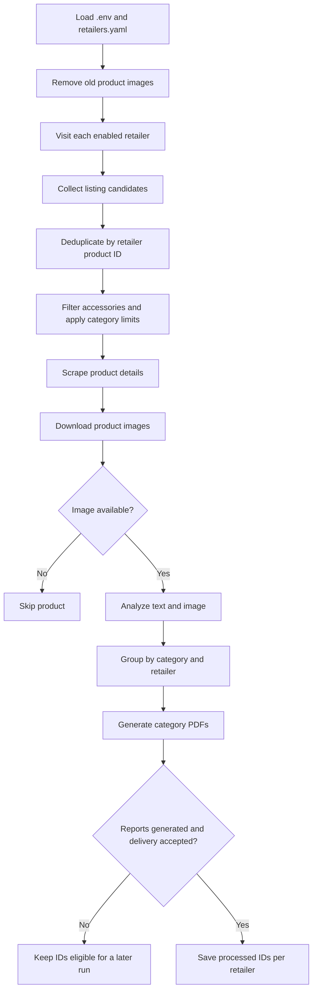

# Fashion Trend Monitor

Fashion Trend Monitor turns retailer-specific new-arrival pages into a consistent product dataset, then produces category-based PDF reports with product images and visual analysis. The current configuration covers H&M, Zara, Lacoste, U.S. Polo Assn., SHEIN, and HUGO BOSS.

## The pipeline



The workflow is sequential. Each retailer scraper returns the shared `Product` model, so the storage, analysis, and PDF stages can use the same downstream pipeline.

## Sample report

This sample came from a live run on 25 October 2026. It contains 12 men's products from six retailers across 14 pages. Select the cover preview to open the complete PDF in GitHub's scrollable document viewer.

[](docs/showcase/fashion-trend-report-men-2026-10-25.pdf)

## What makes the scraping retailer-specific

Retailer sites expose different listing structures, product identifiers, pagination, and detail data. The scrapers share a small interface, but keep the extraction logic that fits each site.

- H&M and Zara can be configured with regional listing URLs. Their products are deduplicated across configured regions.
- H&M uses article codes and site-specific selectors. Its implementation checks for access-denied pages. Source comments document Akamai blocking as the reason Camoufox was chosen for its browser sessions.
- Zara has a separate extraction path. It scrolls to load products, reads product IDs from URL patterns, and checks `zara.analyticsData` and page metadata for product details.
- Lacoste, U.S. Polo Assn., SHEIN, and HUGO BOSS each have their own scraper module for their listing and detail-page structures.

The project also uses a shared browsing helper that waits for a randomized interval, moves the pointer, and occasionally scrolls. Some scrapers add their own pagination or lazy-loading steps. These measures support site-specific browsing behavior; they do not guarantee that a retailer will allow access on every run.

Camoufox is a Firefox-based browser with fingerprint handling implemented at the browser's C++ layer. That is browser-engine code, not an operating-system kernel patch. Its purpose is to keep browser-reported properties consistent; it cannot guarantee that a WAF will accept a session. See the [Camoufox fingerprint documentation](https://camoufox.com/fingerprint/).

## Candidate limits for development

Each retailer currently has these values in `retailers.yaml`:

| Limit | Current value | What it controls |
|---|---:|---|
| `max_items_per_category` | 2 | Final accepted garments per category and retailer |
| `max_candidate_pool_size` | 12 | Listing candidates collected per category before filtering |
| `max_pages_per_category` | 2 | Page-based pagination where that scraper uses page counts |

Candidate and final garment limits are separate. The candidate pool gives the pipeline room to remove previously seen items and accessories before filling the final garment quota. Scrapers that use scrolling or retailer-specific pagination retain those mechanics while respecting the candidate cap.

## Product and resource lifecycle

Before accessory filtering, the pipeline removes products already recorded for that retailer in `data/seen_products.json`. Scrapers map each site's product key into the shared `Product.art_no` field. Depending on the site, that key is an article code, SKU, numeric product ID, or URL-derived identifier. For example, H&M uses its article code, Lacoste reads a SKU, and Zara and SHEIN parse product IDs from product URLs. Some scrapers use a URL path segment when the site does not expose a more suitable identifier. These IDs are scoped by retailer, so the same string from two different stores does not collide.

The pipeline then checks product names and URLs against a list of accessory and non-garment terms. Candidates that pass this deterministic filter are classified by NVIDIA NIM as garments or accessories. Classification requests run sequentially and stop for a category once its accepted garment limit is full. If classification is unavailable or fails, the current fallback treats the candidate as a garment, so this failure path can admit an accessory.

At the start of a run, the shared image folder is cleared of old `.png`, `.jpg`, and `.jpeg` files. The current run downloads product images there for analysis and PDF generation. The images remain available after the run and are removed at the next run.

For products that go through a fresh visual-analysis call, the analyzer wrapper clears `raw_page_text` after analysis returns. Product records and analysis results remain available for grouping and PDF generation. This releases the larger page-text field without discarding data needed by the report.

Product IDs are stored separately for each retailer. The pipeline saves IDs only for categories whose PDF was generated and when email delivery succeeds or is intentionally skipped because SMTP is not configured. Failed PDF generation or email delivery leaves those IDs eligible for a later run.

## AI analysis and fallback behavior

The pipeline first filters obvious accessories using product names and URLs. When NVIDIA NIM is configured, it can also classify remaining candidates as garments or accessories. That classifier returns a permissive garment result if the key is absent or the request fails, so an AI outage does not stop scraping.

For products with images, `AIRequestManager` sends visual-analysis requests one at a time, adds a configurable delay between them, records batch outcomes, and isolates unexpected item failures. The analyzer retries rate-limited visual-analysis calls with exponential backoff. Other request errors become an error analysis for that product. If no NVIDIA key is configured, the analyzer returns clearly labeled default analysis instead of calling the service. The garment-classification request has its own fallback and does not use the visual-analysis retry loop.

The analyzer uses scraped product text for product attributes and the downloaded image for visual observations. The PDF can therefore show text-derived details alongside visual notes and a confidence score.

## PDF reports

One shared ReportLab renderer creates a separate PDF for each category. Each report can include a branded cover, contents and navigation, retailer sections, product images, product details, and AI visual-analysis cards. Retailers provide names, logos, and products as data; the presentation stays in one common generator.

Generated reports are written to the folder configured by `OUTPUT_PATH` (the default is `output/`). Report generation is covered by the unit tests; no retailer site or NVIDIA service is needed to run those tests.

## Adding a retailer

To add a brand:

1. Add its enabled flag, display name, logo, category URLs, and optional limits to `retailers.yaml`.
2. Add a scraper module under `src/scrapers/` that implements `BaseScraper` methods for listing discovery, product details, and image acquisition.
3. Register the scraper in `src/scrapers/__init__.py`.
4. Add or update unit tests for its ID extraction and configuration.

The new scraper returns the shared `Product` model. The existing deduplication, garment filtering, AI analysis, email, and PDF stages then handle it without a retailer-specific report generator.

## Setup

Python 3.10 or newer is recommended.

### Windows PowerShell

```powershell
cd D:\fashion_monitor
python -m venv .venv
.\.venv\Scripts\Activate.ps1
python -m pip install -r requirements.txt
python -m camoufox fetch
Copy-Item .env.example .env
```

### Linux or macOS

```bash
cd /path/to/fashion_monitor
python3 -m venv .venv
source .venv/bin/activate
python -m pip install -r requirements.txt
python -m camoufox fetch
cp .env.example .env
```

Edit `.env` with your NVIDIA and SMTP credentials and runtime settings. The project creates runtime folders as needed. Camoufox browser binaries are installed separately with `python -m camoufox fetch`. On Windows, Smart App Control may block Camoufox; `REPORT.md` records the Linux and WSL2 operational note.

## Configuration

### `retailers.yaml`

Each retailer entry controls whether it is enabled, its display name, logo, category URLs, and optional per-retailer limits. A category can map to one URL or to region-specific URLs.

### `.env`

| Variable | Purpose | Example default |
|---|---|---|
| `NVIDIA_API_KEY` | NVIDIA NIM key; empty uses default analysis | Placeholder |
| `NVIDIA_NIM_MODEL` | Vision model | `meta/llama-3.2-11b-vision-instruct` |
| `NVIDIA_BASE_URL` | NVIDIA API endpoint | `https://integrate.api.nvidia.com/v1` |
| `AI_MAX_RETRIES` | Attempts for rate-limited visual analysis | `4` |
| `AI_REQUEST_DELAY` | Delay between visual-analysis requests, in seconds | `1.5` |
| `HEADLESS` | Run browser without a visible window | `true` |
| `MAX_PAGES_PER_CATEGORY` | Fallback page limit | `2` |
| `MAX_ITEMS_PER_CATEGORY` | Fallback final garment limit | `2` |
| `MAX_CANDIDATE_POOL_SIZE` | Fallback listing candidate limit | `12` |
| `NAV_TIMEOUT` | Navigation timeout, in milliseconds | `45000` |
| `SMTP_SERVER`, `SMTP_PORT` | SMTP host and port | Gmail, `587` |
| `SMTP_USER`, `SMTP_PASSWORD` | SMTP login | Placeholder |
| `NOTIFICATION_EMAIL` | Report recipient | Placeholder |
| `STORAGE_PATH` | Seen-product state | `data/seen_products.json` |
| `OUTPUT_PATH` | Output path; reports use its parent folder | `output/report.pdf` |
| `SCREENSHOT_DIR` | Product image folder | `screenshots` |
| `LOG_FILE` | Application log path | `logs/app.log` |

Per-retailer YAML values override the matching limit variables. Relative paths are resolved from the project directory.

## Run and test

Run one monitoring cycle:

```powershell
python -m src.main
```

Run the offline unit tests:

```powershell
python -m pytest
```

The tests use temporary files and mock external services. They do not prove that retailer websites, NVIDIA credentials, or SMTP delivery will work in a live run.

## Project layout

```text
fashion_monitor/
├── assets/                 # PDF logos, backgrounds, icons, and fonts
├── data/                   # Persistent seen-product state
├── logs/                   # Runtime logs
├── output/                 # Generated category reports
├── screenshots/            # Downloaded product images
├── src/
│   ├── scrapers/            # Retailer-specific browser and extraction logic
│   ├── ai_analyzer.py       # NVIDIA NIM requests and fallbacks
│   ├── ai_manager.py        # Sequential request batching and isolation
│   ├── config.py            # Environment and YAML configuration
│   ├── email_sender.py      # SMTP report delivery
│   ├── main.py              # Monitoring workflow
│   ├── models.py            # Product and analysis data models
│   ├── reporter.py          # Shared PDF report generator
│   └── storage.py           # Per-retailer seen-product state
├── tests/                   # Offline unit tests
├── .env.example             # Environment template
├── retailers.yaml           # Retailer URLs and development limits
└── requirements.txt         # Python dependencies
```
